# Cardiology Project - Detailed Class Diagram (PlantUML)

This diagram focuses on the core functional data model used across patient context, care pathways, diagnostics, imaging, and billing modules.

Primary source models:
- src/contexts/PatientContext.tsx
- src/pages/CarePathways.tsx
- src/pages/Diagnostics.tsx
- src/pages/ECGReports.tsx
- src/pages/HeartImaging.tsx
- src/pages/CardiologyBilling.tsx

```plantuml
@startuml
hide methods
skinparam classAttributeIconSize 0
skinparam linetype ortho

package "Patient Context" {
  class Patient {
    +id: string
    +name: string
    +age: number
    +gender: Gender
    +dossier: string
    +riskLevel: RiskLevel
    +diagnosis: string
    +bloodType: string?
    +insurance: string?
    +lastVisit: string
    +phone: string?
  }
}

package "Care Pathways" {
  class Protocol {
    +id: string
    +name: string
    +category: string
    +description: string
    +steps: number
    +duration: string
    +activePatients: number
    +completedPatients: number
    +status: ProtocolStatus
    +color: string
    +icon: React.ElementType
  }

  class PatientProtocol {
    +id: string
    +patient: string
    +protocol: string
    +currentStep: number
    +totalSteps: number
    +startDate: string
    +nextAction: string
    +status: PatientProtocolStatus
    +progress: number
  }
}

package "Diagnostics" {
  class CardiacAnomaly {
    +id: string
    +type: string
    +severity: Severity
    +location: string
    +description: string
    +detected: string
    +confidence: number
  }

  class FollowUpPlan {
    +id: string
    +anomalyId: string
    +anomalyType: string
    +severity: Severity
    +scheduledDate: string
    +scheduledTime: string
    +followUpType: string
    +specialist: string
    +channel: FollowUpChannel
    +reminderDays: number
    +notes: string
    +createdAt: string
    +updatedAt: string
  }

  class TreatmentPlan {
    +id: string
    +title: string
    +category: string
    +priority: TreatmentPriority
    +status: TreatmentStatus
    +startDate: string
    +duration: string
    +medications: string[]
    +procedures: string[]
    +nextReview: string
  }
}

package "ECG Reports" {
  class ECGRecord {
    +id: string
    +patient: string
    +age: number
    +date: string
    +time: string
    +type: string
    +cardiologue: string
    +status: ECGStatus
    +heartRate: number
    +prInterval: number
    +qrsDuration: number
    +qtInterval: number
    +diagnosis: string
    +recommendations: string[]
    +notes: string
    +ecgImageSrc: string?
  }

  class ECGImageAnnotation {
    +id: string
    +type: AnnotationType
    +color: string
    +strokeWidth: number
    +x: number
    +y: number
    +width: number?
    +height: number?
    +endX: number?
    +endY: number?
    +text: string?
    +points: Point[]?
  }
}

package "Heart Imaging" {
  class ImagingStudy {
    +id: number
    +patient: string
    +age: number
    +modality: Modality
    +date: string
    +ef: number?
    +lvDimension: string?
    +wallThickness: string?
    +findings: string
    +severity: ImagingSeverity
    +status: ImagingStatus
    +aiFindings: string[]
    +dicomFile: File?
    +dicomImageUrl: string?
  }

  class DicomTag {
    +tag: string
    +name: string
    +vr: string
    +value: string
  }

  class DicomMeta {
    +patientName: string
    +patientId: string
    +patientBirthDate: string
    +patientSex: string
    +studyDate: string
    +studyTime: string
    +studyDescription: string
    +seriesDescription: string
    +modality: string
    +institutionName: string
    +rows: number
    +columns: number
    +bitsAllocated: number
    +windowCenter: string
    +windowWidth: string
    +transferSyntax: string
  }
}

package "Billing" {
  class BillingRecord {
    +id: number
    +patient: string
    +date: string
    +procedure: string
    +cptCode: string
    +amount: number
    +insurance: string
    +status: BillingStatus
  }

  class CPTCode {
    +code: string
    +description: string
    +price: number
    +category: string
  }

  class InsuranceProvider {
    +name: string
    +acceptanceRate: number
    +avgProcessingDays: number
    +pendingClaims: number
    +color: string
  }

  class FSERecord {
    +id: string
    +patient: string
    +date: string
    +act: string
    +amount: number
    +organism: string
    +reimbursementStatus: FSEStatus
    +reimbursementDate: string
  }

  class CardioFSE {
    +id: string
    +patient: string
    +date: string
    +mutuelle: string
    +amount: number
    +status: CardioFSEStatus
  }

  class CardioReimbursement {
    +id: string
    +patient: string
    +date: string
    +mutuelle: string
    +reimbursedAmount: number
    +originalAmount: number
    +coverage: string
    +fseRef: string
  }

  class CardioInsurance {
    +patient: string
    +mutuelle: string
    +coverageType: string
    +coverageRate: string
    +annualLimit: number
    +remainingLimit: number
    +status: CoverageStatus
  }

  class PaymentLink {
    +id: string
    +patient: string
    +amount: number
    +createdDate: string
    +status: PaymentLinkStatus
    +link: string
  }

  class PaymentPlan {
    +id: string
    +patient: string
    +totalAmount: number
    +monthlyAmount: number
    +duration: number
    +paidMonths: number
    +status: PaymentPlanStatus
  }

  class DevisRecord {
    +id: string
    +number: string
    +patient: string
    +date: string
    +acts: string
    +totalAmount: number
    +status: DevisStatus
  }
}

' Inferred cross-module relationships (based on field semantics)
Patient "1" -- "0..*" PatientProtocol : patient (name)
Protocol "1" -- "0..*" PatientProtocol : protocol (name)

Patient "1" -- "0..*" TreatmentPlan : patient context
CardiacAnomaly "1" -- "0..*" FollowUpPlan : anomalyId

Patient "1" -- "0..*" ECGRecord : patient (name)
ECGRecord "1" -- "0..*" ECGImageAnnotation : ecgAnnotations

Patient "1" -- "0..*" ImagingStudy : patient (name)
ImagingStudy "1" -- "0..*" DicomTag : dicomTags
ImagingStudy "1" -- "0..1" DicomMeta : dicomMeta

Patient "1" -- "0..*" BillingRecord : patient (name)
CPTCode "1" -- "0..*" BillingRecord : cptCode
InsuranceProvider "1" -- "0..*" BillingRecord : insurance

Patient "1" -- "0..*" FSERecord : patient (name)
Patient "1" -- "0..*" CardioFSE : patient (name)
CardioFSE "1" -- "0..*" CardioReimbursement : fseRef
Patient "1" -- "0..*" CardioInsurance : patient (name)

Patient "1" -- "0..*" PaymentLink : patient (name)
Patient "1" -- "0..*" PaymentPlan : patient (name)
Patient "1" -- "0..*" DevisRecord : patient (name)

@enduml
```

## Notes
- This is a class/domain diagram derived from TypeScript interfaces and app-level data models.
- Several relationships are semantic (name/code based) because many models are UI-state/data-contract oriented rather than strict normalized database entities with explicit foreign keys.
- If needed, this can be converted into a strict SQL schema (PK/FK) in a follow-up document.
