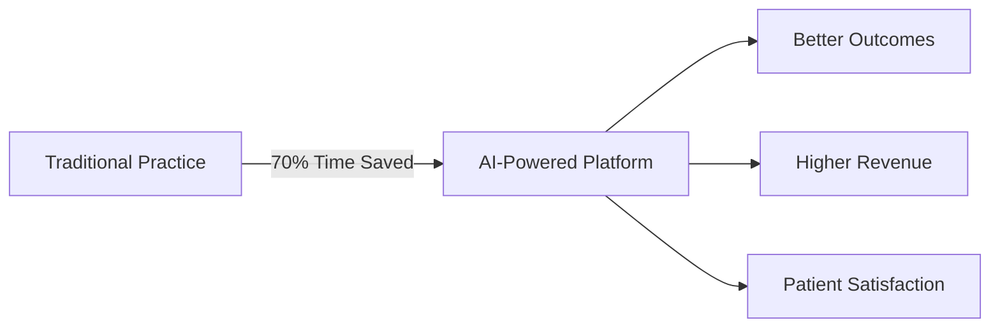

# How to Convert Marketing Presentation to PPTX/PDF

## Quick Conversion Options

### Option 1: Using Slidev (Recommended for Developers)
```bash
# Install Slidev
npm install -g @slidev/cli

# Create a new Slidev presentation
slidev MARKETING_PRESENTATION.md

# Export to PDF
slidev export MARKETING_PRESENTATION.md --output presentation.pdf

# Export to PPTX (requires additional setup)
slidev export MARKETING_PRESENTATION.md --format pptx
```

### Option 2: Using Marp (Simple & Fast)
```bash
# Install Marp CLI
npm install -g @marp-team/marp-cli

# Convert to PDF
marp MARKETING_PRESENTATION.md --pdf --output presentation.pdf

# Convert to PPTX
marp MARKETING_PRESENTATION.md --pptx --output presentation.pptx

# With custom theme
marp MARKETING_PRESENTATION.md --theme custom.css --pdf
```

### Option 3: Using Pandoc (Universal Converter)
```bash
# Install Pandoc (https://pandoc.org/installing.html)

# Convert to PPTX
pandoc MARKETING_PRESENTATION.md -o presentation.pptx

# Convert to PDF (requires LaTeX)
pandoc MARKETING_PRESENTATION.md -o presentation.pdf

# With custom template
pandoc MARKETING_PRESENTATION.md --reference-doc=template.pptx -o presentation.pptx
```

### Option 4: Online Tools (No Installation)
1. **Slides.com**: Import markdown, export as PDF/PPTX
2. **Google Slides**: Copy content, format manually
3. **Canva**: Use presentation templates, paste content
4. **Beautiful.ai**: AI-powered slide generation

## Recommended Workflow

### For Professional Results:

1. **Convert with Marp/Slidev** → Get base slides
2. **Import to PowerPoint/Keynote** → Add branding
3. **Enhance with Canva/Figma** → Professional diagrams
4. **Final export** → PDF for distribution, PPTX for editing

## Adding Visual Diagrams

### Create diagrams using:
- **Mermaid.js** (in markdown)
- **Excalidraw** (hand-drawn style)
- **Figma** (professional)
- **Lucidchart** (flowcharts)

### Example Mermaid Diagram (add to markdown):


## Styling Tips

### For Marp, create a custom theme (custom.css):
```css
/* @theme custom */
section {
  background: linear-gradient(135deg, #667eea 0%, #764ba2 100%);
  color: white;
  font-family: 'Inter', sans-serif;
}

h1 {
  color: #ffffff;
  font-size: 3em;
  text-shadow: 2px 2px 4px rgba(0,0,0,0.3);
}

section.title {
  background: linear-gradient(135deg, #667eea 0%, #764ba2 100%);
  text-align: center;
}
```

## Quick Start Commands

```bash
# Clone the docs folder
cd docs

# Install Marp
npm install -g @marp-team/marp-cli

# Generate PDF
marp MARKETING_PRESENTATION.md --pdf --allow-local-files

# Generate PPTX
marp MARKETING_PRESENTATION.md --pptx --allow-local-files

# Open in browser for preview
marp MARKETING_PRESENTATION.md --preview
```

## Professional Enhancement Checklist

- [ ] Add company logo to title slide
- [ ] Use consistent color scheme (brand colors)
- [ ] Add high-quality screenshots of the platform
- [ ] Include customer testimonials with photos
- [ ] Add QR codes for demo signup
- [ ] Include speaker notes for each slide
- [ ] Optimize images for file size
- [ ] Test on different devices (mobile, tablet, desktop)
- [ ] Create both 16:9 and 4:3 versions
- [ ] Add slide numbers and footer

## Distribution Formats

**For Investors:**
- PDF (non-editable, professional)
- Include financial model spreadsheet
- Add executive summary document

**For Sales/Marketing:**
- PPTX (editable for customization)
- Include demo video links
- Add case study documents

**For Website:**
- PDF (downloadable)
- SlideShare/LinkedIn upload
- Embedded video walkthrough
