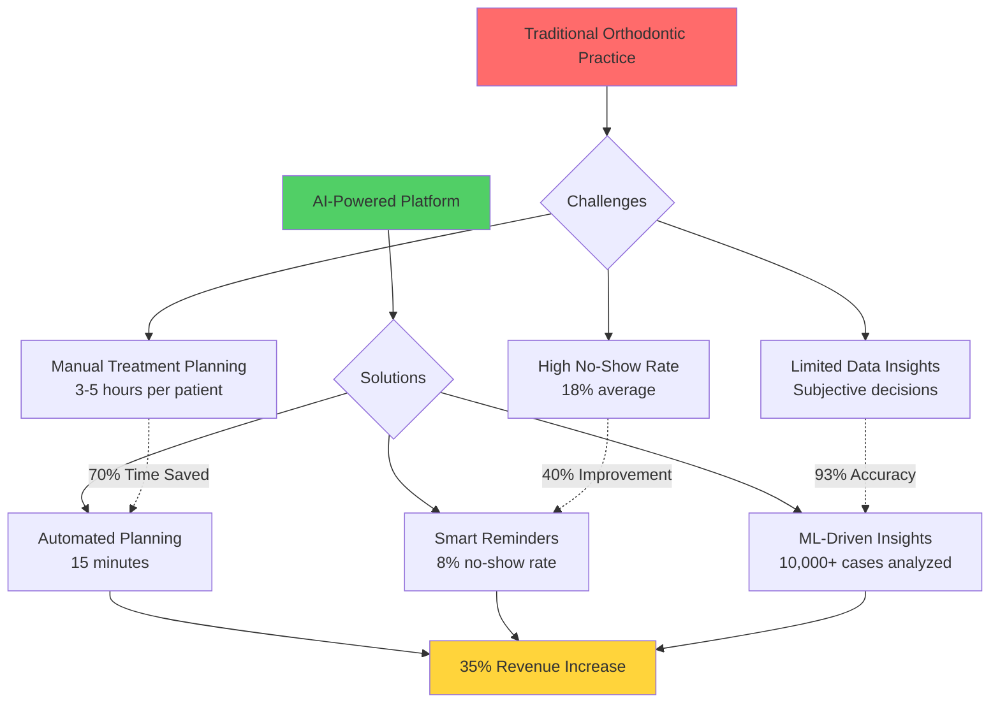
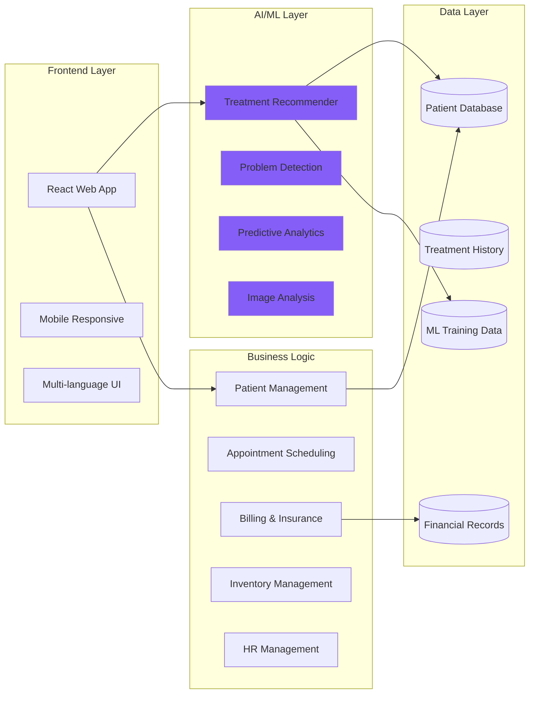
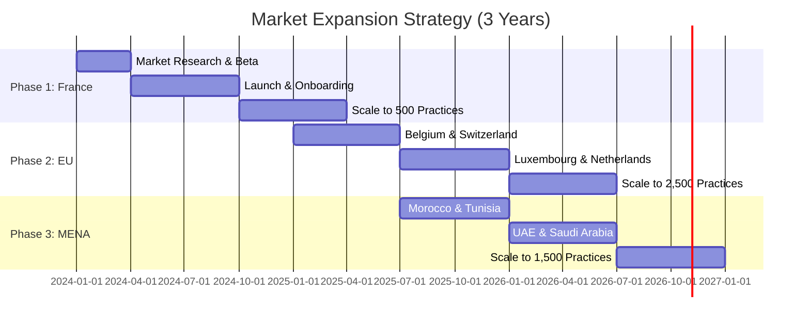
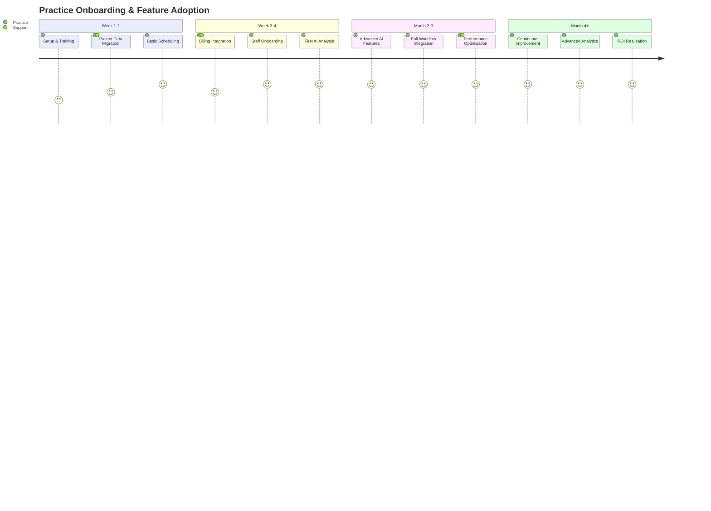
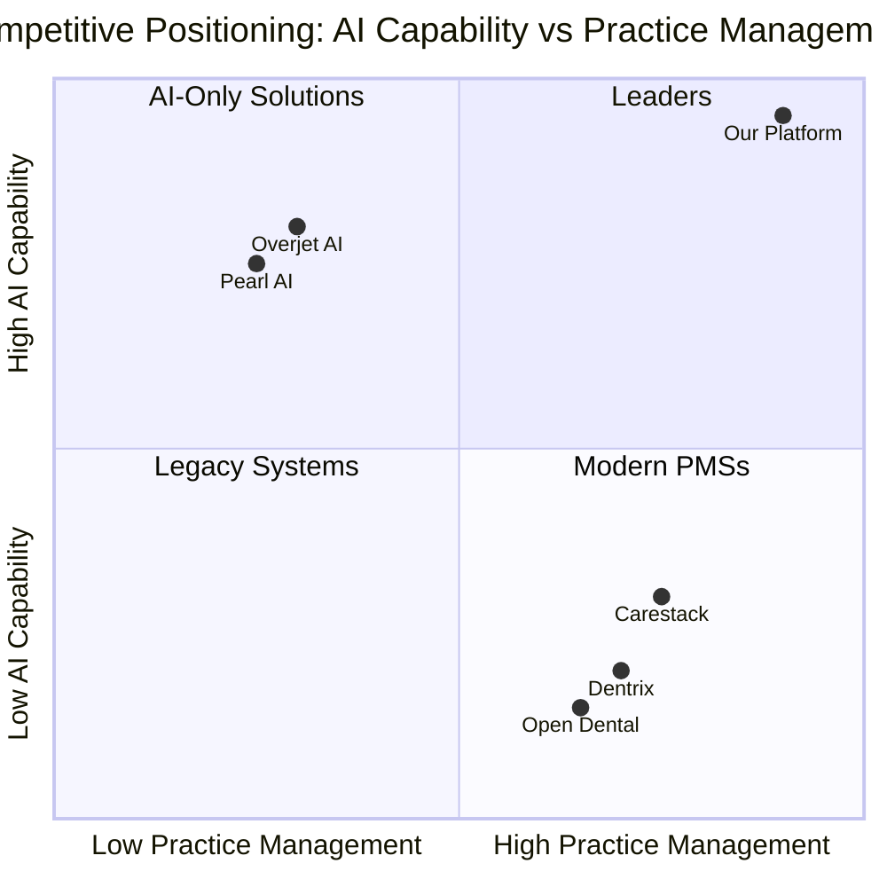
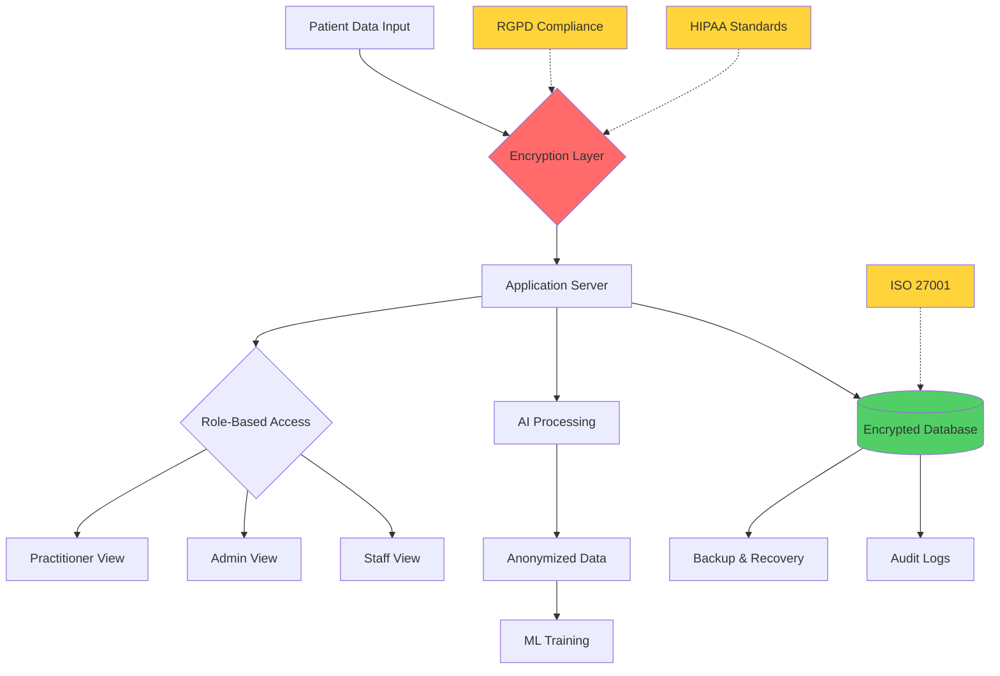
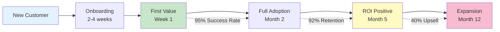

# Visual Diagrams for Marketing Presentation

## Diagram 1: AI Value Proposition Flow



## Diagram 2: Platform Architecture Overview



## Diagram 3: Market Expansion Timeline



## Diagram 4: ROI Breakdown (Mid-Size Practice)

```mermaid
pie title Annual Financial Impact
    "Time Savings" : 85000
    "Revenue Increase" : 157500
    "Efficiency Gains" : 45000
    "Reduced No-Shows" : 35000
    "Platform Cost" : -12000
```

## Diagram 5: Feature Adoption Journey



## Diagram 6: Competitive Positioning Matrix



## Diagram 7: Data Flow & Security



## Diagram 8: Customer Success Metrics



## How to Use These Diagrams

### In Marp Presentation:
```markdown
---
# AI Value Proposition


- 70% time savings
- 40% better attendance
- 35% revenue growth
```

### In PowerPoint:
1. Render diagrams using Mermaid Live Editor (mermaid.live)
2. Export as PNG/SVG
3. Import into PowerPoint slides
4. Add animations and transitions

### In PDF:
1. Use Mermaid CLI to generate images
2. Include in markdown before conversion
3. Or add manually in post-processing

## Rendering Commands

```bash
# Install Mermaid CLI
npm install -g @mermaid-js/mermaid-cli

# Generate all diagrams
mmdc -i PRESENTATION_DIAGRAMS.md -o diagrams/

# Generate specific diagram
mmdc -i diagram1.mmd -o diagram1.png -w 1920 -H 1080

# With custom theme
mmdc -i diagram1.mmd -o diagram1.png -t forest
```

## Color Schemes for Diagrams

**Primary Brand Colors:**
- Primary: `#667eea` (Indigo)
- Secondary: `#764ba2` (Purple)
- Success: `#51cf66` (Green)
- Warning: `#ffd43b` (Yellow)
- Error: `#ff6b6b` (Red)

**Professional Palette:**
- Background: `#ffffff` / `#1a1a1a` (dark mode)
- Text: `#2d3748` / `#e2e8f0` (dark mode)
- Accent: `#4299e1` (Blue)
